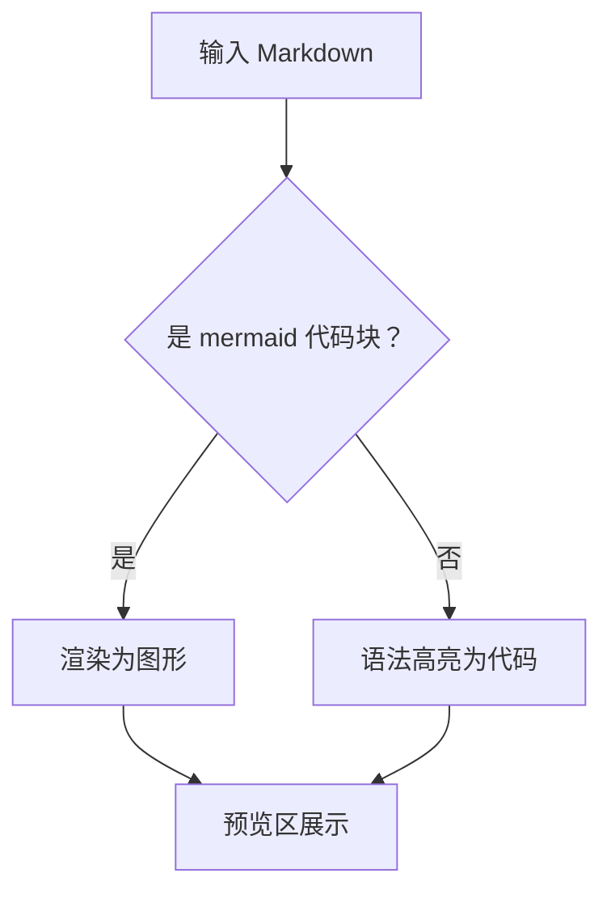

# MarkView

一个完全在浏览器里运行的 Markdown 实时预览工具：左侧编辑，右侧即时渲染。所有文档都保存在你自己的浏览器中——无需注册、无需联网、没有服务器。支持暗色 / 浅色主题、命令面板、链接分享，还可以安装到桌面离线使用。

## 功能一览

### 编辑与预览

- **实时预览**：左侧输入，右侧即时渲染；两侧滚动双向同步，看到哪写到哪
- **流畅输入**：渲染在后台进行，文档再长打字也不卡顿
- **顺手的编辑器**：行号、Markdown 语法高亮，代码块按语言（JS / Python / CSS / HTML 等）高亮；括号引号自动配对、`Tab` / `Shift + Tab` 缩进
- **智能补全**：输入 `](` 时自动补全文档路径与标题锚点；代码块内提供对应语言的补全
- **一键格式化**：`Ctrl + Alt + F` 整篇规范排版——表格对齐、列表符号统一、空行规范，JS / JSON / CSS / HTML 代码块一并格式化。不重排正文换行（中文段落安全），光标保持原位，`Ctrl + Z` 一步整体撤销
- **插入图片**：粘贴或拖入图片，自动压缩后嵌进文档，随文档一起保存与分享；编辑区把冗长的图片数据折叠成小占位，不碍眼
- **代码块**：`Ctrl + Alt + K` 插入围栏代码块，光标直接停在语言标记位，敲 `json` / `js` 即可（选中文本时把选区包进围栏）；预览区显示语言角标，hover 一键复制
- **任务列表**：`- [ ]` / `- [x]` 渲染为复选框，在预览区直接点击勾选，状态自动写回源码（可撤销），嵌套任务同样支持
- **数学公式**：行内 `$…$` 与块级 `$$…$$` 公式（KaTeX 渲染）
- **Mermaid 图表**：标注 `mermaid` 的代码块自动画成流程图 / 时序图，并跟随明暗主题配色
- **暗色 / 浅色主题**：右上角一键切换，首次跟随系统，之后记住你的选择
- **专注阅读**：一键折叠编辑区，只留预览；分栏宽度、目录宽度都可拖拽调整，手机上自动切换上下布局

### 文档管理

- **多文档**：新建、切换、删除多个文档，每个文档有独立的撤销历史
- **自动保存**：边写边存，头部实时显示保存状态，关掉再开内容还在
- **打开本地文件**（Chrome / Edge 等浏览器）：`Ctrl + O` 打开电脑上的 Markdown 文件，编辑后 `Ctrl + S` 直接写回原文件，`Ctrl + Shift + S` 另存为新文件并打开；安装为桌面应用后，双击 `.md` 文件即可用 MarkView 打开
- **改动有数**：切回窗口时自动检查文件是否在别处被改过——只有对方改了就静默刷新，两边都改了会弹窗让你决定，绝不悄悄覆盖；文件被移动、重命名或删除时也会提示，可另存或仅保留在 MarkView 中；在 MarkView 里删除文档不会动你电脑上的文件（Firefox / Safari 暂不支持写回，可用「导入 + 导出」代替）
- **多标签页**：同时开多个标签页，文档状态实时同步，正在编辑的内容不会被覆盖
- **自动命名**：根据标题或正文自动起文件名，重名自动加序号；关联本地文件的文档始终跟本地文件同名
- **导入导出**：点击按钮或直接把文件拖进窗口即可导入；「更多」菜单可导出 Markdown、自包含 HTML（离线可读），或导出 PDF（文字可选中、体积小）
- **链接分享**：一键把整篇文档压缩进链接，对方打开链接即可看到全文，不经过任何服务器
- **离线可用**：可安装到桌面 / 手机主屏，断网也能照常使用

### 导航与搜索

- **全局搜索**：`Ctrl + K` 唤起，按文件名与正文跨文档搜索，选中结果精确定位到行并双侧高亮
- **查找替换**：`Ctrl + F` 在当前文档内查找 / 替换，实时显示命中数，支持大小写 / 全词 / 正则；`F3` / `Shift + F3` 跳转命中
- **命令面板**：`Ctrl + P` 唤起，输入关键字执行新建、导出、切换主题等所有命令；越常用的命令排得越靠前
- **目录导航**：按标题自动生成目录，点击跳转，当前位置自动高亮跟随
- **标题锚点**：hover 预览区标题点击 `#`，复制直达该标题的链接
- **阅读进度**：预览区顶部进度条随滚动填充；滚得深了右下角出现「回到顶部」
- **文档统计**：实时显示行数、字数、字符数与图片数

> macOS 上以上快捷键的 `Ctrl` 对应 `Cmd`。

## 使用提示

| 操作              | 方式                                                                             |
| ----------------- | -------------------------------------------------------------------------------- |
| 切换文档          | 点击面板头部左侧的文件名下拉                                                     |
| 新建 / 清空       | 编辑区头部按钮，或 `Ctrl + Alt + N` 新建、`Ctrl + Alt + X` 清空                  |
| 打开本地文件      | 头部「打开本地文件」按钮或 `Ctrl + O`，编辑后可直接保存回原文件（Chrome / Edge） |
| 导入文件          | 头部「导入」按钮、`Ctrl + Alt + O`，或把文件直接拖进窗口                         |
| 保存              | 自动保存；`Ctrl + S` 立即保存（关联本地文件时直接写回原文件）                    |
| 另存为            | `Ctrl + Shift + S` 另存为新文件并打开（不支持的浏览器降级为下载）                |
| 导出              | 头部 `⋯` 更多菜单：导出 Markdown / HTML / PDF                                    |
| 插入图片          | 粘贴，或把图片拖进窗口                                                           |
| 分享文档          | 头部分享按钮或 `Ctrl + Alt + C`，复制自包含链接                                  |
| 全局搜索          | `Ctrl + K`，回车或点击结果定位到行                                               |
| 查找替换          | `Ctrl + F`，支持大小写 / 全词 / 正则，`F3` 跳下一个命中                          |
| 命令面板          | `Ctrl + P`，输入关键字模糊匹配命令                                               |
| 一键格式化        | `Ctrl + Alt + F`，或命令面板「格式化文档」                                       |
| 插入代码块        | `Ctrl + Alt + K`，或命令面板「插入代码块」                                       |
| 切换主题          | 右上角主题按钮、`Ctrl + Alt + L`，或命令面板                                     |
| 折叠 / 展开编辑区 | 编辑区头部 `<` 折叠，预览区头部 `>` 恢复，或 `Ctrl + \`                          |
| 调整布局          | 拖拽编辑区与预览区之间的分割条；拖拽目录左侧边缘调整目录宽度                     |
| 复制标题链接      | hover 预览区标题，点击 `#` 锚点                                                  |

## 数据保存在哪里？

MarkView 完全运行在你的浏览器里，文档保存在当前站点的浏览器本地存储中。这意味着：

- 清理浏览器站点数据会丢失所有文档
- 更换浏览器或设备后无法读取原有内容
- 重要文档请记得导出备份，或用分享链接留档

关联了本地文件的文档是例外：内容真身是你电脑上的那个文件，`Ctrl + S` 写回后不受浏览器数据清理影响——清理后重新打开该文件即可。

## Markdown 语法演示

以下内容演示 MarkView 支持的常见 Markdown 语法，可直接在左侧编辑区修改，右侧立刻看到效果。

### 1. 标题

# H1 标题

## H2 标题

### H3 标题

### 2. 列表

- 无序列表项 1
- 无序列表项 2
    - 嵌套列表项 2.1
    - 嵌套列表项 2.2
- 无序列表项 3

1. 有序列表项 1
2. 有序列表项 2
3. 有序列表项 3

- [x] 任务列表：已完成项
- [ ] 任务列表：待办项（在预览区点击复选框试试，状态会回写到左侧源码）

### 3. 代码块

```javascript
function greet(name) {
    console.log(`你好，${name}！`)
    return `欢迎 ${name}`
}

greet('Vue 3 开发者')
```

```python
def fibonacci(n):
    a, b = 0, 1
    for _ in range(n):
        yield a
        a, b = b, a + b

print(list(fibonacci(10)))
```

### 4. 表格

| 名称     | 类型     | 描述                   |
| -------- | -------- | ---------------------- |
| Vue      | 框架     | 渐进式 JavaScript 框架 |
| Vite     | 构建工具 | 下一代前端构建工具     |
| Markdown | 标记语言 | 轻量级标记语言         |

### 5. 引用

> 技术不在于复杂，而在于优雅地解决问题。
> -- 某位开发者

### 6. 链接与图片

[访问 Vue 官网](https://vuejs.org/)


### 7. 其他样式

- **粗体文字**
- _斜体文字_
- ~~删除线~~
- `行内代码`

---

## Mermaid 流程图

在代码块标注 `mermaid` 语言即可绘制流程图、时序图等，预览区会自动渲染为图形，并跟随明暗主题切换配色：



## 数学公式（KaTeX）

行内公式用单个 `$` 包裹，例如质能方程 $E = mc^2$、勾股定理 $c = \sqrt{a^2 + b^2}$；块级公式用 `$$` 独占一行：

$$
\int_{a}^{b} f(x)\,\mathrm{d}x = F(b) - F(a)
$$

$$
\sum_{i=1}^{n} i = \frac{n(n+1)}{2}
$$
