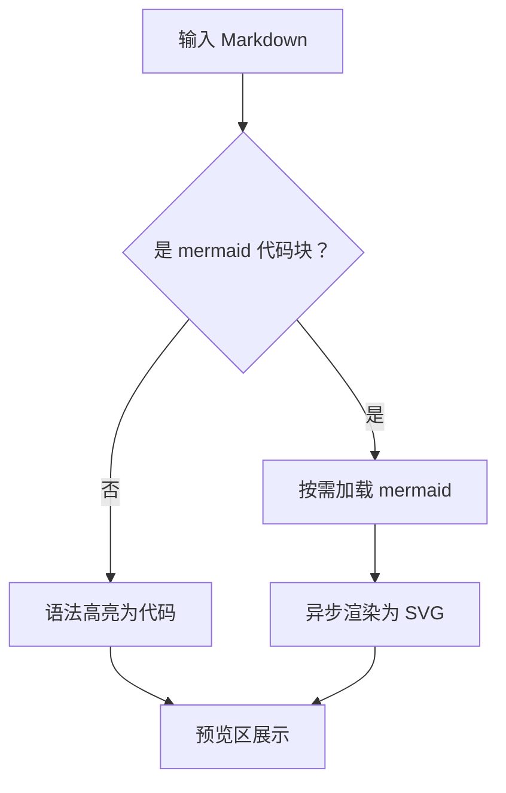

# README

一个纯前端的本地 Markdown 实时预览工具：左侧 CodeMirror 6 编辑，右侧实时渲染，所有数据保存在浏览器 IndexedDB 中，无需任何后端。支持暗色/浅色主题、命令面板、URL 分享，并作为 PWA 离线安装使用。

基于 Vue 3 + Vite 构建，核心逻辑与 UI 严格分层，纯逻辑层零 Vue、零 DOM，全部由 Vitest 直测覆盖。

## 功能一览

### 编辑与预览

- **实时预览**：左侧输入 Markdown，右侧即时渲染；编辑区与预览区按源码行号双向滚动同步
- **后台线程渲染**：Markdown 渲染跑在 Web Worker 里，主线程输入不卡顿；Worker 不可用时自动降级为主线程同步渲染
- **CodeMirror 6 编辑器**：行号、Markdown 语法高亮、围栏代码块按语言（JS / TS / CSS / HTML / Python / JSON / XML 等）嵌套高亮
- **编辑辅助**：括号 / 引号自动配对与匹配高亮、成对删除，`Tab` / `Shift + Tab` 缩进
- **智能补全**：输入 `](` 时补全工作区文档路径与当前文档的标题锚点；代码块内提供对应语言的补全
- **图片内联**：粘贴图片、或把图片拖入窗口任意位置，自动压缩（大图缩放 + WebP 编码）为 base64 内联进当前文档；编辑区将超长 base64 折叠为「⋯ 图片数据 ⋯」占位，文档内容不受影响
- **代码块增强**：预览区代码块显示语言角标，hover 一键复制
- **任务列表**：`- [ ]` / `- [x]` 渲染为复选框，预览区点击即勾选 / 取消，状态直接回写源码对应行（可 `Ctrl + Z` 撤销），嵌套任务同样支持
- **数学公式**：KaTeX 渲染行内 `$…$` 与块级 `$$…$$` 公式
- **Mermaid 图表**：标注 `mermaid` 的代码块异步渲染为 SVG，并跟随明暗主题切换配色
- **暗色 / 浅色主题**：右上角一键切换，首次跟随系统偏好，之后记忆本地选择
- **编辑区折叠**：一键折叠编辑区专注阅读，文件切换与操作按钮自动移入预览区头部
- **可调布局**：编辑区 / 预览区分栏、目录宽度均可拖拽调整；移动端自动切换上下布局

### 文档管理

- **多文档工作区**：新建、切换、删除多个文档，每个文档拥有独立的撤销历史
- **自动保存**：内容变更增量写入 IndexedDB，头部实时显示保存状态
- **多标签页同步**：同一站点开多个标签页时，文档状态经 BroadcastChannel 实时同步，正在编辑的文档不会被其他标签页覆盖
- **智能命名**：根据标题或正文自动生成文件名，导入文件同样按内容识别命名
- **导入导出**：点击头部按钮选择、或把文件拖入窗口任意位置——文本文件（`.md` / `.markdown` / `.txt` 等）导入为独立文档、图片内联进当前文档、其他格式即时提示不支持；「更多」菜单可导出 Markdown、自包含 HTML（内联样式、离线可读），或经浏览器原生打印导出 PDF
- **URL 分享**：一键把当前文档压缩进链接 hash，链接自包含、无需后端；打开分享链接即还原文档
- **PWA 离线可用**：可安装到桌面 / 主屏，构建产物预缓存后断网也能使用
- **系统文件处理器**：PWA 安装后注册为 `.md` / `.markdown` 的文件处理器，双击本地文件即用 MarkView 打开并导入为新文档

### 导航与搜索

- **全局搜索**：`Ctrl + K`（macOS：`Cmd + K`）唤起，按文件名与正文跨文档检索，选中结果精确定位到行并在编辑区、预览区双侧高亮
- **查找替换**：`Ctrl + F`（macOS：`Cmd + F`）在当前文档内查找 / 替换，实时显示「当前 / 总命中数」，输入框内嵌区分大小写、全字匹配、正则开关；`F3` / `Shift + F3` 跳上一个 / 下一个命中，替换框内 `Enter` 替换当前命中、`Ctrl + Alt + Enter` 全部替换；编辑区折叠时自动先展开
- **命令面板**：`Ctrl + P`（macOS：`Cmd + P`）唤起，模糊匹配执行新建 / 导入 / 导出 / 分享 / 切换主题 / 折叠 / 切换文档等命令，常用命令右侧展示快捷键；命令按使用频率排序（本地记忆），越常用越靠前
- **全局快捷键**：标准操作用单修饰——`Ctrl + O` 导入、`Ctrl + F` 查找替换、`Ctrl + \` 折叠 / 展开编辑区；应用命令统一 `Ctrl + Alt`——`N` 新建文档、`C` 复制分享链接、`X` 清空内容、`L` 切换主题（macOS 中 `Ctrl` 对应 `Cmd`）
- **目录导航**：按标题自动生成目录，点击跳转，当前标题高亮自动跟随滚动
- **标题锚点**：预览区标题 hover 显示 `#`，点击复制带 hash 的完整链接；刷新或新标签打开可直达对应标题
- **阅读进度条**：预览区顶部随滚动从左向右填充，内容不足一屏时自动隐藏
- **回到顶部**：预览区滚动较深时右下角出现快捷返回按钮
- **文档统计**：实时显示行数、字数、字符数与图片数（字数统计自动剔除内联 base64 数据）

## 技术栈

| 依赖                                                 | 用途                                 |
| ---------------------------------------------------- | ------------------------------------ |
| [Vue 3](https://vuejs.org/)                          | 组合式 API + `<script setup>`        |
| [Vite](https://vitejs.dev/)                          | 开发服务器与构建                     |
| [vite-plugin-pwa](https://vite-pwa-org.netlify.app/) | PWA 清单与离线预缓存                 |
| [CodeMirror 6](https://codemirror.net/)              | 编辑器（高亮、补全、行号、搜索高亮） |
| [marked](https://marked.js.org/)                     | Markdown 解析与渲染（Web Worker 内） |
| [highlight.js](https://highlightjs.org/)             | 预览区代码块语法高亮                 |
| [KaTeX](https://katex.org/)                          | 数学公式渲染                         |
| [Mermaid](https://mermaid.js.org/)                   | 流程图 / 时序图等图表渲染            |
| [lz-string](https://github.com/pieroxy/lz-string)    | 分享链接的文档压缩编解码             |
| [Vitest](https://vitest.dev/)                        | 核心逻辑单元测试                     |

PDF 导出不依赖第三方库，直接走浏览器原生打印（文字可选、体积小的矢量输出），版式由 `styles/print.css` 的 `@media print` 控制。

## 快速开始

需要本地已安装 Node.js 与 pnpm。

```bash
pnpm install
pnpm dev
```

开发服务器默认运行在 `http://localhost:3001/`。

### 常用命令

```bash
pnpm dev           # 启动开发环境
pnpm build         # 构建生产版本（产物在 dist/）
pnpm preview       # 本地预览生产构建
pnpm test          # 运行单元测试（Vitest）
pnpm lint          # ESLint 检查
pnpm format        # Prettier 格式化
pnpm format:check  # Prettier 格式检查
pnpm check         # 一键校验：lint + 格式检查 + 测试 + 构建
```

## 架构设计

采用 CodeMirror-First 分层架构，依赖严格单向向下：

```text
components（哑组件，inject 工作区直接消费）
    ↓
workspace（响应式状态 + 横切编排）
    ↓
controllers（EditorController / PreviewController，命令式门面）
    ↓
core（纯逻辑领域层：零 Vue、零 DOM，Vitest 直测）
```

- **components** 只负责 UI，不含业务逻辑；通过 `provide/inject` 获取工作区
- **workspace** 持有全部响应式状态（文档会话、搜索会话、布局会话），跨子系统流程（搜索定位、折叠编排等）集中在 `orchestrations`
- **controllers** 封装 CodeMirror 与预览 DOM 的命令式能力，是组件之下操作编辑器 / 预览的唯一入口
- **core** 是可独立测试的纯函数领域层：文档模型、持久化调度、Markdown 渲染与源行标注、跨文档搜索、滚动锚点表、分享链接编解码

### 目录结构

```text
src/
├── main.js / App.vue        # 入口 + 根布局（组装并 provide 工作区，渲染骨架屏 / 分栏）
├── styles/                  # 设计 token 与全局样式（tokens / base / markdown / highlights / print）
├── core/                    # 纯逻辑领域层
│   ├── documents/           # 文档模型、IndexedDB 存储、保存状态机、多标签同步协调
│   ├── markdown/            # marked 渲染、源行标注、代码高亮、数学扩展、slug、渲染 Worker
│   ├── search/              # 跨文档搜索、匹配、摘要
│   ├── share/               # 分享链接（lz-string）编解码
│   ├── sync/                # 滚动锚点表与防回环
│   └── text.js              # 通用文本工具
├── editor/                  # CodeMirror 6 封装（无 Vue）
│   ├── EditorController.js  # 编辑器唯一门面（多文档独立 EditorState）
│   └── extensions/          # 主题、语法高亮、链接/代码补全、搜索高亮、图片粘贴/压缩/折叠、代码语言等扩展
├── preview/                 # 预览 DOM 门面（源行定位、搜索高亮、mermaid 渲染）
├── workspace/               # 响应式状态 + 横切编排
│   ├── createWorkspace.js   # 组装会话 / 控制器 / 生命周期，provide 下发
│   ├── documentSession.js   # 多文档状态与持久化
│   ├── searchSession.js     # 搜索查询与命中
│   ├── layoutSession.js     # 分栏宽度 / 折叠 / 目录宽度
│   ├── previewRenderSession.js # 预览渲染调度（Worker / 降级）
│   ├── markdownRenderer.js  # Web Worker 渲染门面与降级
│   ├── toastSession.js / confirmSession.js # 全局提示与确认弹窗
│   ├── headingNavigation.js # 标题 hash 导航
│   └── orchestrations.js    # 搜索定位、折叠展开等跨子系统流程
├── composables/             # 通用 UI 工具（主题、拖拽、媒体查询、偏好持久化、剪贴板等）
├── services/exporter.js     # Markdown / HTML 导出与原生打印（PDF）
├── components/              # 哑组件（工具栏、命令面板、主题切换、编辑/预览面板、目录、搜索、提示等）
├── constants/presets.js     # 预置文档
└── assets/                  # SVG 图标资源
```

测试文件（`*.test.js`）与被测模块同目录放置，`pnpm test` 一键运行。

## 使用提示

| 操作              | 方式                                                                                     |
| ----------------- | ---------------------------------------------------------------------------------------- |
| 切换文档          | 点击面板头部左侧的文件名下拉                                                             |
| 新建 / 清空       | 编辑区头部按钮，或 `Ctrl + Alt + N` 新建、`Ctrl + Alt + X` 清空                          |
| 导入              | 头部导入按钮或 `Ctrl + O` 选择多个文件，或把文件拖入窗口任意位置；非文本文件会提示不支持 |
| 自动保存          | 内容自动保存；`Ctrl + S` / `Cmd + S` 立即写入并提示                                      |
| 导出              | 头部 `⋯` 更多菜单：导出 Markdown / 导出 HTML / 导出 PDF（浏览器打印）                    |
| 插入图片          | 粘贴，或把图片拖入窗口任意位置，自动压缩并以 base64 内联进当前文档                       |
| 分享文档          | 头部分享按钮或 `Ctrl + Alt + C` 复制自包含链接，或命令面板选「复制分享链接」             |
| 全局搜索          | `Ctrl + K` / `Cmd + K` 唤起，回车或点击结果定位到行                                      |
| 查找替换          | `Ctrl + F` / `Cmd + F` 唤起面板，支持大小写 / 全词 / 正则，`F3` 跳下一个命中             |
| 命令面板          | `Ctrl + P` / `Cmd + P` 唤起，输入关键字模糊匹配命令                                      |
| 切换主题          | 顶部工具栏右上角主题按钮、`Ctrl + Alt + L`，或命令面板切换                               |
| 折叠 / 展开编辑区 | 编辑区头部 `<` 折叠；预览区头部 `>` 恢复；或 `Ctrl + \` 切换                             |
| 调整分栏          | 拖拽编辑区与预览区之间的分割条                                                           |
| 调整目录宽度      | 拖拽目录左侧边缘                                                                         |
| 复制标题链接      | hover 预览区标题，点击 `#` 锚点                                                          |

## 部署

通过环境变量 `VITE_APP_PATH` 控制 Vite 的 `base` 路径：

- `.env.development`：本地开发默认 `/`
- `.env.production`：生产构建默认 `/markview/`
- `.env.vercel`：Vercel 等根路径平台部署用 `/`

部署到 GitHub / Gitee Pages 且仓库名不是 `markview` 时，修改 `.env.production`：

```env
VITE_APP_PATH=/your-repo-name/
```

部署到根域名或自定义域名则改为：

```env
VITE_APP_PATH=/
```

之后执行 `pnpm build`，将 `dist/` 目录发布即可。

## 数据存储说明

MarkView 完全运行在浏览器端，文档数据保存在当前站点的 IndexedDB 中。这意味着：

- 清理浏览器站点数据会丢失所有文档
- 更换浏览器、设备或部署路径后无法读取原有内容
- 重要文档请定期通过导出或分享链接备份

作为 PWA 安装后，构建产物会被预缓存以支持离线使用，但文档数据仍只存于本地 IndexedDB，缓存与数据互不替代。

## Markdown 语法演示

以下内容演示 MarkView 支持的常见 Markdown 语法，可直接在编辑器中修改查看效果。

### 1. 标题

# H1 标题

## H2 标题

### H3 标题

### 2. 列表

- 无序列表项 1
- 无序列表项 2
    - 嵌套列表项 2.1
    - 嵌套列表项 2.2
- 无序列表项 3

1. 有序列表项 1
2. 有序列表项 2
3. 有序列表项 3

- [x] 任务列表：已完成项
- [ ] 任务列表：待办项（在预览区点击复选框试试，状态会回写到左侧源码）

### 3. 代码块

```javascript
function greet(name) {
    console.log(`你好，${name}！`)
    return `欢迎 ${name}`
}

greet('Vue 3 开发者')
```

```python
def fibonacci(n):
    a, b = 0, 1
    for _ in range(n):
        yield a
        a, b = b, a + b

print(list(fibonacci(10)))
```

### 4. 表格

| 名称     | 类型     | 描述                   |
| -------- | -------- | ---------------------- |
| Vue      | 框架     | 渐进式 JavaScript 框架 |
| Vite     | 构建工具 | 下一代前端构建工具     |
| Markdown | 标记语言 | 轻量级标记语言         |

### 5. 引用

> 技术不在于复杂，而在于优雅地解决问题。
> -- 某位开发者

### 6. 链接与图片

[访问 Vue 官网](https://vuejs.org/)


### 7. 其他样式

- **粗体文字**
- _斜体文字_
- ~~删除线~~
- `行内代码`

---

## Mermaid 流程图

在代码块标注 `mermaid` 语言即可绘制流程图、时序图等，预览区会异步渲染为 SVG，并跟随明暗主题切换配色：



## 数学公式（KaTeX）

行内公式用单个 `$` 包裹，例如质能方程 $E = mc^2$、勾股定理 $c = \sqrt{a^2 + b^2}$；块级公式用 `$$` 独占一行：

$$
\int_{a}^{b} f(x)\,\mathrm{d}x = F(b) - F(a)
$$

$$
\sum_{i=1}^{n} i = \frac{n(n+1)}{2}
$$
